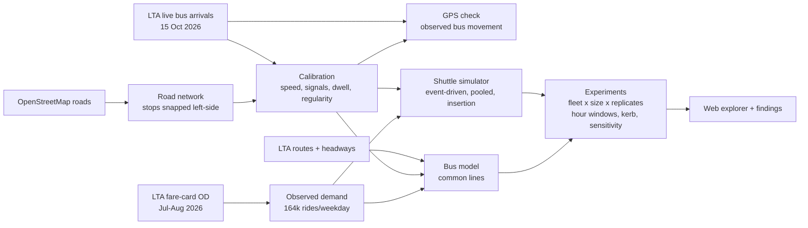

# Driverless Yishun

**Could autonomous shuttles carry every bus ride inside a mature Singapore town, and what would that take?**

A simulation study of Yishun (221,610 residents, Census 2020). It replays every bus ride that starts and ends *inside* the town, using LTA fare-card counts for an average school-term weekday of July–August 2026 (about 164,000 rides). Those rides go through a fleet of pooled, on-demand autonomous shuttles and are compared, ride by ride, with today's bus network. The road model is calibrated to LTA's live bus data and checked against observed bus GPS movement.


<!-- FINDINGS -->

## Why this question (and not the one in the brief)

The starting brief proposed a SUMO microsimulation of 0–80 % *private* autonomous cars, plus V2X roadside units, new signal strategies and parking conversion. Checking it against evidence changed the project. The full record is in [`docs/decision.md`](docs/decision.md).

- **Singapore's AVs are fleets serving towns.**
  - Car ownership is capped by the vehicle quota.
  - The national AV passenger fleet is "16 passenger vehicles, all in Punggol" (MOT, 18 Sep 2026). Punggol is about to trial point-to-point service "within the whole estate, without the need for fixed routes".
  - LTA stopped a planned autonomous-bus pilot on two public bus services in October 2026, to look at narrower uses first (reported by Mothership, confirmed by LTA).
- **The brief's mechanism would echo its own assumptions.**
  - Car-following AV models mostly reflect the headways you give them.
  - Singapore's signals already run on the adaptive GLIDE system.
  - Junction counts suitable for calibration are sparse one-day surveys (2017 – Jan 2024).
- **The data that does exist is better than the brief knew.** LTA's fare-card OD gives *observed* rides between every pair of stops by hour. Its live bus feed allows a real calibration of road speed, signal delay, bus dwell and headway regularity.

So the project asks: if the on-demand model Punggol is trialling had to serve all of Yishun's internal bus riders, how many vehicles, how much driving and how much kerb would it need? The closest Singapore study, Mo et al. (2021, *TR-C* 127), simulated shared AVs *competing* with buses for first-mile trips in Tampines. This one holds demand fixed at observed rides and asks what replacing every internal bus ride would take.

## How it works



| | What | Status |
|---|---|---|
| Demand | Rides between every pair of the 180 Yishun stops, by hour, average school-term weekday (July + August 2026; September as a check); Poisson replicates | **Observed** (LTA DataMall `PV/ODBus`) |
| Roads | OSM drive network; stops snapped to the left-hand kerb; routed distances match LTA route distances (median ratio 1.02) | **Observed + checked** |
| Speeds | Cruise multiplier, delay per signal-controlled location, bus dwell per stop and at stations, fitted on 171,838 live arrival-estimate pairs (10:00–12:59); held-out services 18 % error vs 30 % for distance alone | **Calibrated** |
| Speed check | Chained GPS positions of the same bus: observed/modelled time 0.99 at midday, about 1.07 in the evening peak; dwell measured independently (40 s) | **Observed** |
| Bus | Common-lines model over LTA routes and published headways; wait factor κ = 0.57 from GPS-monitored headways; one simulated wait per ride for tails | **Modelled** |
| Shuttles | Event-driven simulation; immediate insertion dispatch (kernel verified against brute force); re-routing at any node; demand-led repositioning | **Simulated** |
| Not modelled | Demand change, fares, congestion feedback, charging, safety operators, bus crowding, the morning-peak road speeds | **Assumed away** (see limitations) |

Details: [`docs/methodology.md`](docs/methodology.md) · Validation: [`docs/validation.md`](docs/validation.md) · Data and licences: [`docs/data.md`](docs/data.md)

## Reproduce

Python 3.12. An [LTA DataMall](https://datamall.lta.gov.sg/content/datamall/en/request-for-api.html) key goes in `LTA_DATAMALL_KEY`. Registration is free.

```bash
make setup                    # uv venv + pinned requirements
make data                     # LTA DataMall, data.gov.sg, OpenStreetMap
make reproduce-core-results   # experiments -> sensitivity -> page data -> tests
make web && make serve        # http://localhost:8000
# optional, at the hours you want to calibrate on:
make live calibrate gps-check calibrate-peak
```

On 4 cores, the experiments and sensitivity take about two and a half hours. The live logs of 15 Oct 2026 cannot be re-downloaded, and DataMall serves fare-card months for only three months. The derived inputs are therefore committed in `data/processed/`: the Yishun OD table, `calibration.json`, `calibration_pm_peak.json` and `gps_check.json`. Every result file records the calibration, demand months and git revision it came from.

```
pipeline/yishun/   fetchers, network, routing, calibration, bus model, simulator, experiments, exporters
tests/             insertion kernel vs brute force, simulator exact times and randomized invariants,
                   kerb queues, common lines, estimator check, demand sampling, bus wait draws,
                   real-network consistency
web/               static explorer (deck.gl + d3), build and screenshot scripts
docs/              decision record, methodology, validation, data registry
data/processed/    calibration and experiment outputs (raw data is never committed)
```

<!-- LIMITATIONS -->

## Credits and licences

Contains information from LTA DataMall, HDB, URA and SingStat, accessed via LTA DataMall and data.gov.sg under the [Singapore Open Data Licence v1.0](https://data.gov.sg/open-data-licence). Map data © OpenStreetMap contributors, [ODbL](https://www.openstreetmap.org/copyright). Code: see repository licence.

This is a simulation study. It is not a forecast of AV adoption, ridership, costs or safety, and it is not an LTA plan.
