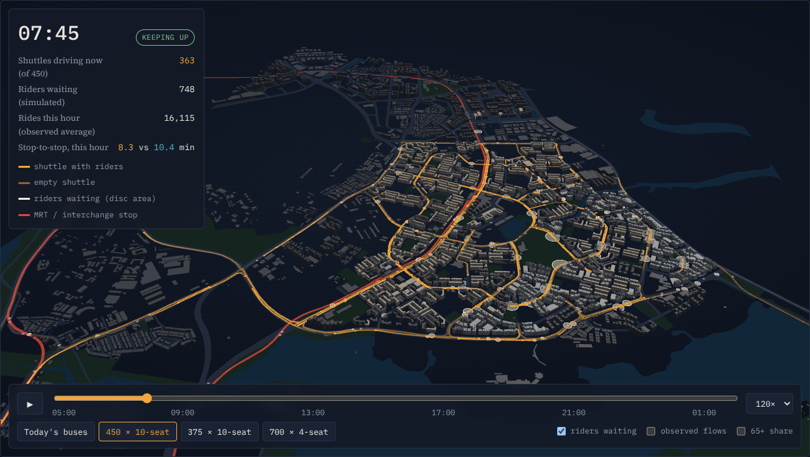
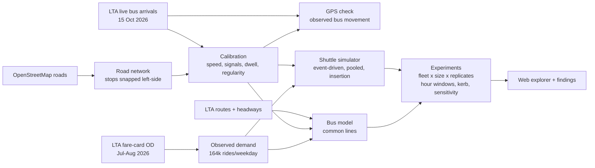
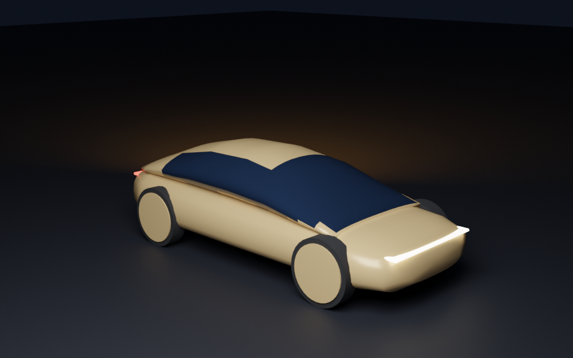
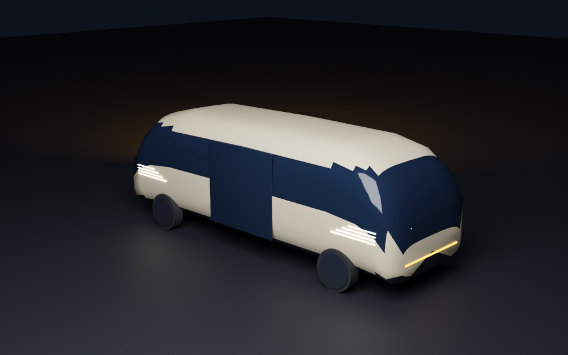
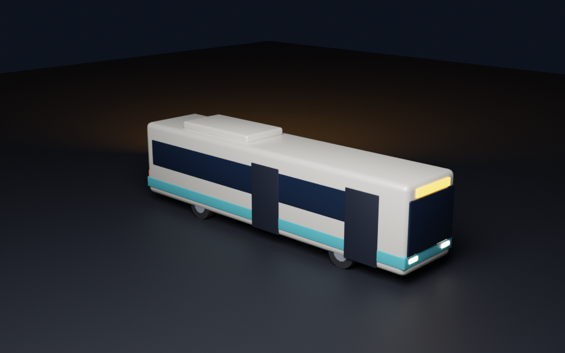
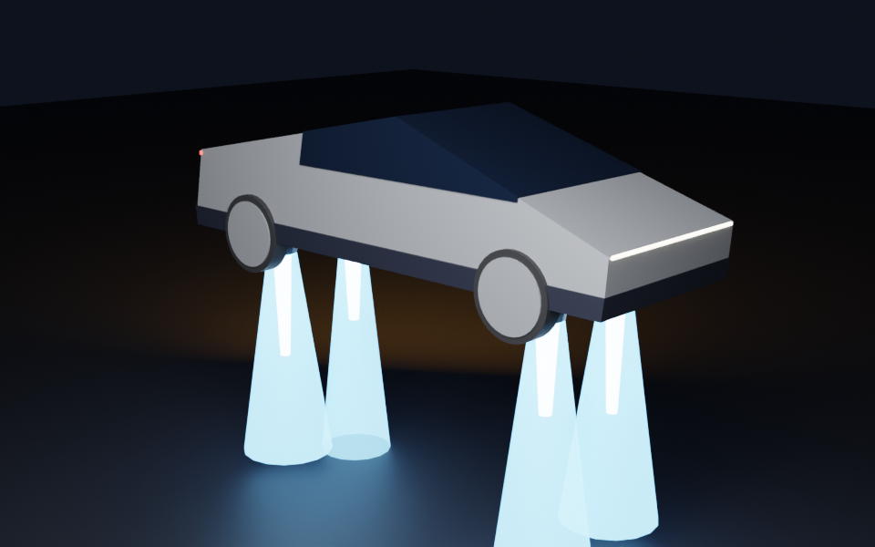

# Driverless Yishun

**Could autonomous shuttles carry every bus ride inside a mature Singapore town, and what would that take?**

A simulation study of Yishun (221,610 residents, Census 2020). It replays every bus ride that starts and ends *inside* the town, using LTA fare-card counts for an average school-term weekday of July–August 2026 (about 164,000 rides). Those rides go through a fleet of pooled, on-demand autonomous shuttles and are compared, ride by ride, with today's bus network. The road model is calibrated to LTA's live bus data and checked against observed bus GPS movement.



<!-- FINDINGS -->
## Findings

1. **The demand is short, hub-bound feeder riding.** 163,745 rides per average school-term weekday (July–August 2026) start and end inside Yishun. The median is 1.06 km in a straight line, and 66% start or end at an MRT station or the interchange. Today's buses deliver 12.0 min stop to stop on average (3.3 waiting + 8.7 riding).
2. **There is a sharp capacity threshold.** With 10-seat shuttles, 450 vehicles keep up with the bus in every hour of all three simulated weekdays (6.9 min at 08:00 against the bus's 10.5 min). With 425, the queue left by the 07:00 rush pushes the 08:00 hour to 11.0 min before it clears; with 375, to 39.6 min, and 1.1% of the day's riders are refused. Above the threshold the shuttle is 45 % faster stop to stop over the day (6.6 vs 12.0 min). Bigger vehicles help less than their seats suggest: 700 four-seat, 450 ten-seat or 375 twenty-seat vehicles, because at the threshold a shuttle carries 1.8 riders on average. Matching the bus's 90th-percentile time in every hour instead needs 450 ten-seat shuttles.
3. **It takes more vehicles than today's buses, and far more driving.** In the model, 450 shuttles is 3.0 times the 152 buses of all services inside Yishun at 07:00 (81 of them feeders). Each bus carries about ten times as many people (about 16,200 places against 4,500 shuttle seats). The fleet drives 160,133 km inside Yishun per weekday, 4.7 times the 33,871 km all buses drive there, carrying 1.8 riders on average against at least 8 per bus-km. Singapore's whole autonomous passenger fleet is 16 vehicles (MOT, Sep 2026).
4. **Feeder theory points the same way.** In a single feeder zone, demand-responsive service beats fixed routes only below about 10–50 riders per square mile per hour (Li & Quadrifoglio 2010). Averaged over the town, Yishun's internal demand at 07:00 is about 2,000 riders per square mile per hour. If the fleet in service could change every hour, the off-peak would need far fewer vehicles (about 200 at midday): at least 5,225 vehicle-hours in service a day instead of 9,450. The fixed fleet spends about 6,632 of its hours driving, against about 1,463 hours of bus driving inside Yishun.
5. **The MRT kerb becomes a bottleneck.** Up to 27 shuttles board or alight at once at the Yishun MRT and interchange stops, and 15 at Khatib, before idle vehicles waiting for work.
6. **Who gains.** With 450 ten-seat shuttles, pooled over 3 simulated weekdays, 92% of rides reach their stop sooner than by bus, comparing each ride with one simulated bus wait (94% beat the bus's average time for that trip). The average saving is 5.4 minutes. Longer rides gain more: 78% of all rides under 0.5 km are faster, against 97% of all rides over 1.5 km, where bus routes loop and stop more often than a direct shuttle. After 20:00, when buses run less often, 98% are faster; in the 07:00–09:00 peak, 78%. The slowest tenth of shuttle rides take more than 10.5 min, against 20.0 min by bus (12.9 against 17.4 min in the 07:00–09:00 peak). Of the rides that are slower by shuttle, 19% are under 0.5 km; in 94% the shuttle wait is longer than the bus wait, and in 18% the shuttle ride is longer than the bus ride.
7. **Kerb capacity is a hard constraint.** Limiting each station to 14 shuttles boarding at once still keeps up at 07:00 (9.4 min). At 10, kerb queues push the 07:00 hour to 41.6 min and the fleet no longer matches the bus. Adding vehicles makes it worse: 500 shuttles with the same kerb take 42.2 min, because the extra vehicles queue too.
8. **The dispatcher is a lever as big as the vehicle.** The simple dispatcher used here considers up to 32 shuttles per request. Considering twice or four times as many lowers the threshold from 450 to 400 or 375.
9. **Sensitivity.** Across 18 alternative assumptions, pushing both ways, the all-day 10-seat fleet ranges 375–550 (base 450). The largest moves: demand +20% (same pattern) (550); demand -20% (same pattern) (375); dispatcher searches four times as many vehicles per request (96 nearest + 32 soonest free) (375).

*Calibration: 171,838 matched LTA arrival estimates on 1,297 stop sequences (10:00–12:59). With whole services held out, error is 18 % against 30 % for distance alone. Observed bus GPS movement takes 0.99× the modelled time at midday and 1.02× in the evening peak, where LTA's estimates imply 1.10×. Fleets are the smallest simulated on a 25-vehicle grid; demand replicates are Poisson draws around the observed average weekday.*

## Why this question (and not the one in the brief)

The starting brief proposed a SUMO microsimulation of 0–80 % *private* autonomous cars, plus V2X roadside units, new signal strategies and parking conversion. Checking it against evidence changed the project. The full record is in [`docs/decision.md`](docs/decision.md).

- **Singapore's AVs are fleets serving towns.**
  - Car ownership is capped by the vehicle quota.
  - The national AV passenger fleet is "16 passenger vehicles, all in Punggol" (MOT, 18 Sep 2026). Punggol is about to trial point-to-point service "within the whole estate, without the need for fixed routes".
  - LTA stopped a planned autonomous-bus pilot on two public bus services in October 2026, to look at narrower uses first (reported by Mothership, confirmed by LTA).
- **The brief's mechanism would echo its own assumptions.**
  - Car-following AV models mostly reflect the headways you give them.
  - Singapore's signals already run on the adaptive GLIDE system.
  - Junction counts suitable for calibration are sparse one-day surveys (2017 – Jan 2024).
- **The data that does exist is better than the brief knew.** LTA's fare-card OD gives *observed* rides between every pair of stops by hour. Its live bus feed allows a real calibration of road speed, signal delay, bus dwell and headway regularity.

So the project asks: if the on-demand model Punggol is trialling had to serve all of Yishun's internal bus riders, how many vehicles, how much driving and how much kerb would it need? The closest Singapore study, Mo et al. (2021, *TR-C* 127), simulated shared AVs *competing* with buses for first-mile trips in Tampines. This one holds demand fixed at observed rides and asks what replacing every internal bus ride would take.

## How it works



| | What | Status |
|---|---|---|
| Demand | Rides between pairs of the 180 Yishun stops (179 have internal rides), by hour, average school-term weekday (July + August 2026; September as a check); Poisson replicates | **Observed** (LTA DataMall `PV/ODBus`) |
| Roads | OSM drive network; stops snapped to the left-hand kerb; routed distances match LTA route distances (median ratio 1.02) | **Observed + checked** |
| Speeds | Cruise multiplier, delay per signal-controlled location, bus dwell per stop and at stations, fitted on 171,838 live arrival-estimate pairs (10:00–12:59); held-out services 18 % error vs 30 % for distance alone | **Calibrated** |
| Speed check | Chained GPS positions of the same bus (same feed, observed positions rather than LTA's estimates): observed/modelled time 0.99 at midday. Evening peak: 1.02 by GPS, against 1.10 by LTA's estimates. Dwell measured directly (40 s) | **Observed** |
| Bus | Common-lines model over LTA routes and published headways; wait factor κ = 0.57 from GPS-monitored headways; one simulated wait per ride for tails | **Modelled** |
| Shuttles | Event-driven simulation; immediate insertion dispatch (kernel verified against brute force); re-routing at any node; demand-led repositioning | **Simulated** |
| Not modelled | Demand change, fares, congestion feedback, charging, safety operators, bus crowding, the morning-peak road speeds | **Assumed away** (see limitations) |

Details: [`docs/methodology.md`](docs/methodology.md) · Validation: [`docs/validation.md`](docs/validation.md) · Data and licences: [`docs/data.md`](docs/data.md)

## Reproduce

Python 3.12. An [LTA DataMall](https://datamall.lta.gov.sg/content/datamall/en/request-for-api.html) key goes in `LTA_DATAMALL_KEY`. Registration is free.

```bash
make setup                    # uv venv + pinned requirements
make data                     # LTA DataMall, data.gov.sg, OpenStreetMap
make reproduce-core-results   # experiments -> sensitivity -> page data -> tests
make web && make serve        # http://localhost:8000 (the game; the study is /study.html)
# optional, at the hours you want to calibrate on:
make live calibrate gps-check calibrate-peak
```

On 4 cores, the experiments and sensitivity take about two and a half hours. The live logs of 15 Oct 2026 cannot be re-downloaded, and DataMall serves fare-card months for only three months. The derived inputs are therefore committed in `data/processed/`: the Yishun OD table, `calibration.json`, `calibration_pm_peak.json` and `gps_check.json`. Every result file records the calibration, demand months and git revision it came from.

```
pipeline/yishun/   fetchers, network, routing, calibration, bus model, simulator, experiments, exporters
tests/             insertion kernel vs brute force, simulator exact times and randomized invariants,
                   kerb queues, common lines, estimator check, demand sampling, bus wait draws,
                   real-network consistency
web/               static explorer (deck.gl + d3), the game (WebGPU, physics.js + tests), build and screenshot scripts
tools/blender/     vehicle models for the explorer, generated in Blender
docs/              decision record, methodology, validation, data registry
data/processed/    calibration and experiment outputs (raw data is never committed)
```

### Vehicle models

The explorer draws each simulated vehicle as a 3D model heading along its route: a robovan for the 10-seat
shuttles, a robotaxi coupe for the 4-seat fleet, and a feeder bus for today's buses. Click a vehicle (or press
**R**) to ride along behind it. The flying trucks circling above the town are decoration and play no part in
the simulation. The models are built from code by [`tools/blender/build_models.py`](tools/blender/build_models.py)
and committed as `web/public/models/*.glb`. To rebuild or restyle them:

```bash
make models BLENDER=/Applications/Blender.app/Contents/MacOS/Blender   # macOS, Blender 4.2+
make models BLENDER="python"                                           # or with `pip install bpy`
```

| Robotaxi (4-seat) | Robovan (10-seat shuttle) | Feeder bus | Flying truck (decorative) |
|---|---|---|---|
|  |  |  |  |

### Night Shift (the game)

The site opens on [Night Shift](web/src/play.html), a driving game on the same data. The study itself is at
`study.html`, linked from the game's menu and corner. Every building footprint and height, road area, park,
stretch of water, the MRT line and the 180 bus stops come from the study's inputs. You drive a robotaxi or
robovan for a five-minute shift. Riders appear at each stop at that hour's observed rate (LTA fare-card OD) and
head for stops riders really travel to. You pick them up, pool them and try to get them there before the bus
would. The shuttles on the road are the simulator's 450-vehicle fleet and the buses are the study's bus model,
both at the same minute. The walkers, private cars, trains and flying trucks are decoration, and "beat the bus"
uses a rough bus estimate made for the game.

**Rendering.** The game draws with three.js's `WebGPURenderer`, which falls back to WebGL 2 by itself where WebGPU
is missing (`?webgl` forces the fallback; the corner badge says which is in use). The shaders are written in
TSL ([`web/src/shaders.js`](web/src/shaders.js)), so one source compiles to WGSL and to GLSL:

- windows look into rooms (interior mapping), with curtains, TV flicker and lights that follow the hour;
- HDB blocks get void decks, corridor stripes, air-conditioner ledges, rain streaks and their block number
  painted on the blank gable ends;
- the sky has drifting clouds, stars and the town's sodium glow at night, and the environment map for
  reflections is baked from it;
- asphalt has patches and puddles that turn the roads wet in the evening;
- lane lines follow the road network the fleet drives, and kerbs carry Singapore's double yellow lines;
- shadows near walls come from an occlusion map baked from the footprints;
- the water has moving waves, trees sway in the wind, and the nearest street lamps are real lights;
- post-processing adds bloom, a vignette and a chromatic kick on hard knocks.

**Physics.** [`web/src/physics.js`](web/src/physics.js) has no dependencies and is tested in Node
(`node --test web/test/*.test.mjs`). Vehicles are rigid boxes with arcade tyres. They collide with each other by
the separating-axis test and trade impulses at the contact point, so a glancing blow spins a car and a square hit
stops it. Walls come from the raster of buildings and water. Trees and bus shelters are solid, and lamp posts
can be knocked over.

- **Hit a walker** and they become a ragdoll (fifteen Verlet joints). The body folds over a low bonnet or is
  pushed ahead by the flat front of a van or bus. They lie still for a moment, get up and walk back. Each person
  struck costs a safety star, and with none left the operator suspends your shift. People dodge vehicles bearing
  down on them (some freeze), and **H** sounds the horn.
- **Hit a robovan, bus or car** and it is knocked out of the simulation. It becomes a wreck that slides, spins
  and keeps its hazard lights on, and it can knock into others. The panels of both vehicles dent where they
  were struck. Sparks, glass and skid marks stay on the road. Damage slows your vehicle and pulls its steering,
  then sets the bonnet smoking. At zero condition it is towed and a fresh one waits at the hub.
- Traffic stops for whatever is in its way: you, a wreck, someone lying in the road.

Clean driving builds a score multiplier (up to ×2), and pooled drop-offs at one stop earn a bonus.
**Space** is the handbrake and **R** recovers a stuck vehicle.

<!-- LIMITATIONS -->
## Limitations

- **Morning peak not observed.** The threshold is set in the 07:00–09:00 rush, but live data were
  collected 10:06–14:57 (with a gap from 12:02 to 12:33) and 17:30–19:30. In the evening peak, LTA's
  estimates imply buses about 10 % slower than the midday model, while chained GPS positions show
  almost no slowdown. One sensitivity case applies the evening-peak calibration all day as the
  cautious stand-in.
- **One day of live data.** The calibration and the GPS check come from Thursday 15 October 2026.
- **Demand held fixed.** Same riders, stops and times as today. Faster trips would attract riders,
  and a $4 fare (Punggol's announced fare) would deter some; neither is modelled. Rides are fare-card
  stages, so a two-bus trip inside Yishun stays two requests.
- **No congestion feedback.** Hundreds of shuttles do not slow each other or the buses. LTA's open
  traffic-volume data covers no estate roads in Yishun (only the Seletar Expressway and slip roads),
  so the added flow could not be compared with measured traffic. Kerb space is unlimited in the base
  case (a limit is tested separately).
- **Bus side.** Running times are calibrated to LTA's real-time *estimates*, checked against GPS
  movement. Crowding and denied boarding are not modelled, which flatters the bus at peaks. Waits
  assume riders arrive at random; riders using live-arrival apps wait less (tested in sensitivity).
- **Dispatcher.** Immediate insertion with exact travel times: neither a batch optimiser (which could
  need fewer vehicles) nor travel-time noise (which would widen tails).
- **Not modelled:** charging and depots, safety operators, breakdowns, fares, costs, emissions, and
  walking to stops (identical in both modes because both serve the same stops).

## Credits and licences

Contains information from LTA DataMall, HDB, URA and SingStat, accessed via LTA DataMall and data.gov.sg under the [Singapore Open Data Licence v1.0](https://data.gov.sg/open-data-licence). Map data © OpenStreetMap contributors, [ODbL](https://www.openstreetmap.org/copyright). Code: see repository licence.

This is a simulation study. It is not a forecast of AV adoption, ridership, costs or safety, and it is not an LTA plan.
