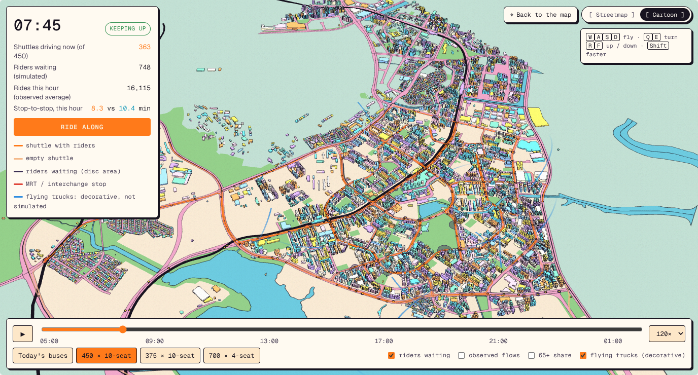
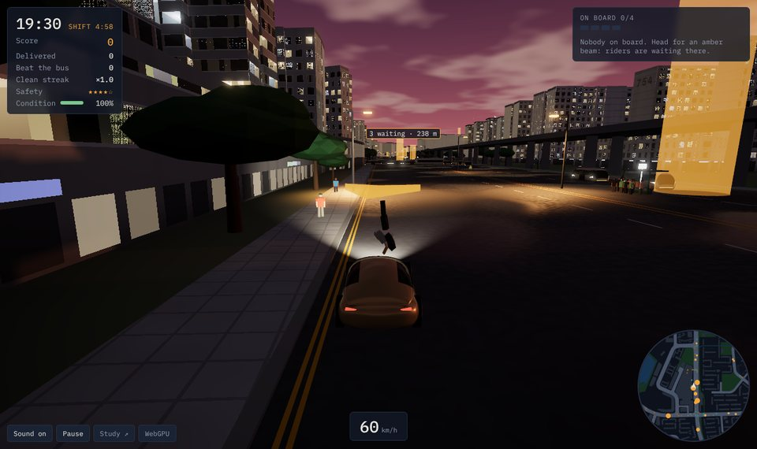
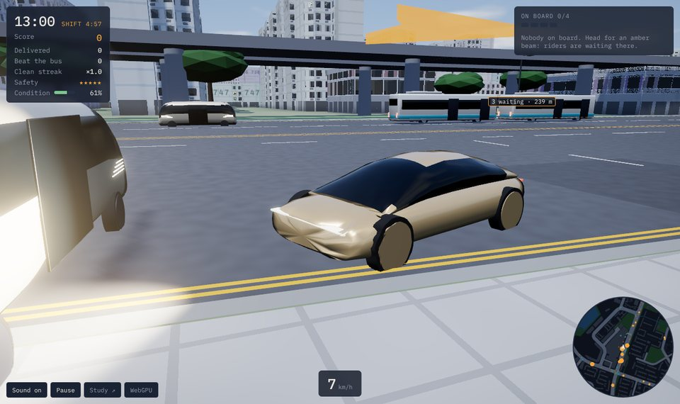

# The explorer's vehicle models and Night Shift

The study's 3D explorer and the driving game built on the same data. Neither affects any result.

## Vehicle models

The explorer draws each simulated vehicle as a 3D model heading along its route: a robovan for the 10-seat
shuttles, a robotaxi coupe for the 4-seat fleet, and a feeder bus for today's buses. Click a vehicle (or press
**R**) to ride along behind it. The flying trucks circling above the town are decoration and play no part in
the simulation. Press **M** (or use the pill in the top-right corner) to switch the map between two
styles: **Streetmap**, a dark street map after [busrouter.sg](https://busrouter.sg/visualization/), and **Cartoon**, a flat
pastel illustration with ink outlines; the choice is remembered, and `#style=toon` links straight to it.



The models are built from code by [`tools/blender/build_models.py`](../tools/blender/build_models.py)
and committed as `web/public/models/*.glb`. To rebuild or restyle them:

```bash
make models BLENDER=/Applications/Blender.app/Contents/MacOS/Blender   # macOS, Blender 4.2+
make models BLENDER="python"                                           # or with `pip install bpy`
```

| Robotaxi (4-seat) | Robovan (10-seat shuttle) | Feeder bus | Flying truck (decorative) |
|---|---|---|---|
|  |  |  |  |

## Night Shift (the game)

The site opens on a landing page ([`web/src/home.html`](../web/src/home.html)) that offers two ways in: the study
(`study.html`) or [Night Shift](../web/src/play.html) (`play.html`), a driving game on the same data. Behind them
loops a night drive recorded in the game by [`web/record_loop.py`](../web/record_loop.py) (`make loop` re-records
it; rendering in software takes about an hour). The page pauses it for visitors who prefer reduced motion or
save data, and it has a pause button. Every building footprint and height, road area, park,
stretch of water, the MRT line and the 180 bus stops come from the study's inputs. You drive a robotaxi or
robovan for a five-minute shift. Riders appear at each stop at that hour's observed rate (LTA fare-card OD) and
head for stops riders really travel to. You pick them up, pool them and try to get them there before the bus
would. The shuttles on the road are the simulator's 450-vehicle fleet and the buses are the study's bus model,
both at the same minute. The walkers, private cars, trains and flying trucks are decoration, and "beat the bus"
uses a rough bus estimate made for the game.

| A walker thrown over the bonnet at 60 km/h (19:30) | The robotaxi's nose after hitting a robovan (13:00) |
|---|---|
|  |  |

**Rendering.** The game draws with three.js's `WebGPURenderer`, which falls back to WebGL 2 by itself where WebGPU
is missing (`?webgl` forces the fallback; the corner badge says which is in use). The shaders are written in
TSL ([`web/src/shaders.js`](../web/src/shaders.js)), so one source compiles to WGSL and to GLSL:

- windows look into rooms (interior mapping), with curtains, TV flicker and lights that follow the hour;
- HDB blocks get void decks, corridor stripes, air-conditioner ledges, rain streaks and their block number
  painted on the blank gable ends;
- the sky has drifting clouds, stars and the town's sodium glow at night, and the environment map for
  reflections is baked from it;
- asphalt has patches and puddles that turn the roads wet in the evening;
- lane lines follow the road network the fleet drives, and kerbs carry Singapore's double yellow lines;
- shadows near walls come from an occlusion map baked from the footprints;
- the water has moving waves, trees sway in the wind, and the nearest street lamps are real lights;
- post-processing adds bloom, a vignette and a chromatic kick on hard knocks.

**Physics.** [`web/src/physics.js`](../web/src/physics.js) has no dependencies and is tested in Node
(`node --test web/test/*.test.mjs`). Vehicles are rigid boxes with arcade tyres. They collide with each other by
the separating-axis test and trade impulses at the contact point, so a glancing blow spins a car and a square hit
stops it. Walls come from the raster of buildings and water. Trees and bus shelters are solid, and lamp posts
can be knocked over.

- **Hit a walker** and they become a ragdoll (fifteen Verlet joints). The body folds over a low bonnet or is
  pushed ahead by the flat front of a van or bus. They lie still for a moment, get up and walk back. Each person
  struck costs a safety star, and with none left the operator suspends your shift. People dodge vehicles bearing
  down on them (some freeze), and **H** sounds the horn.
- **Hit a robovan, bus or car** and it is knocked out of the simulation. It becomes a wreck that slides, spins
  and keeps its hazard lights on, and it can knock into others. The panels of both vehicles dent where they
  were struck. Sparks, glass and skid marks stay on the road. Damage slows your vehicle and pulls its steering,
  then sets the bonnet smoking. At zero condition it is towed and a fresh one waits at the hub.
- Traffic stops for whatever is in its way: you, a wreck, someone lying in the road.

Clean driving builds a score multiplier (up to ×2), and pooled drop-offs at one stop earn a bonus.
**Space** is the handbrake and **R** recovers a stuck vehicle.
