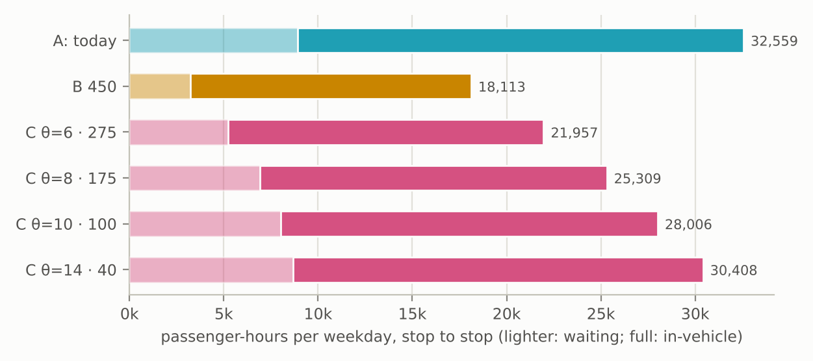
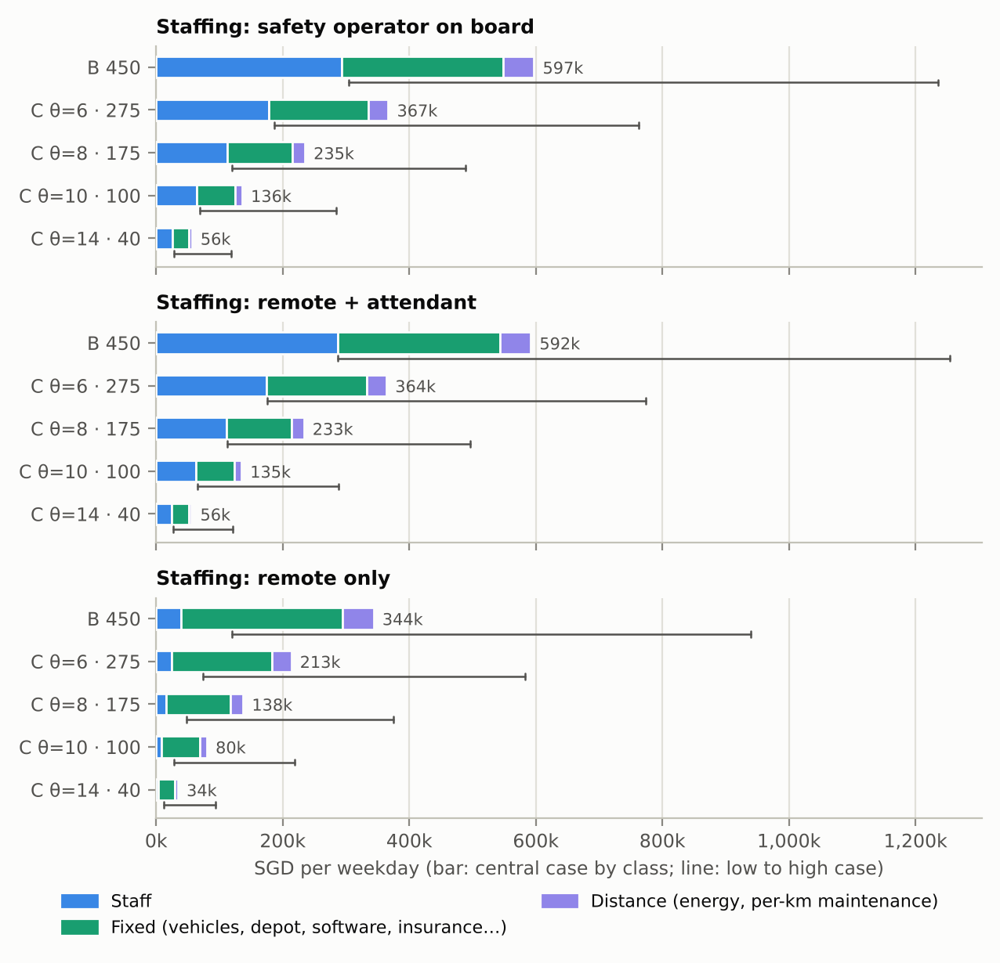
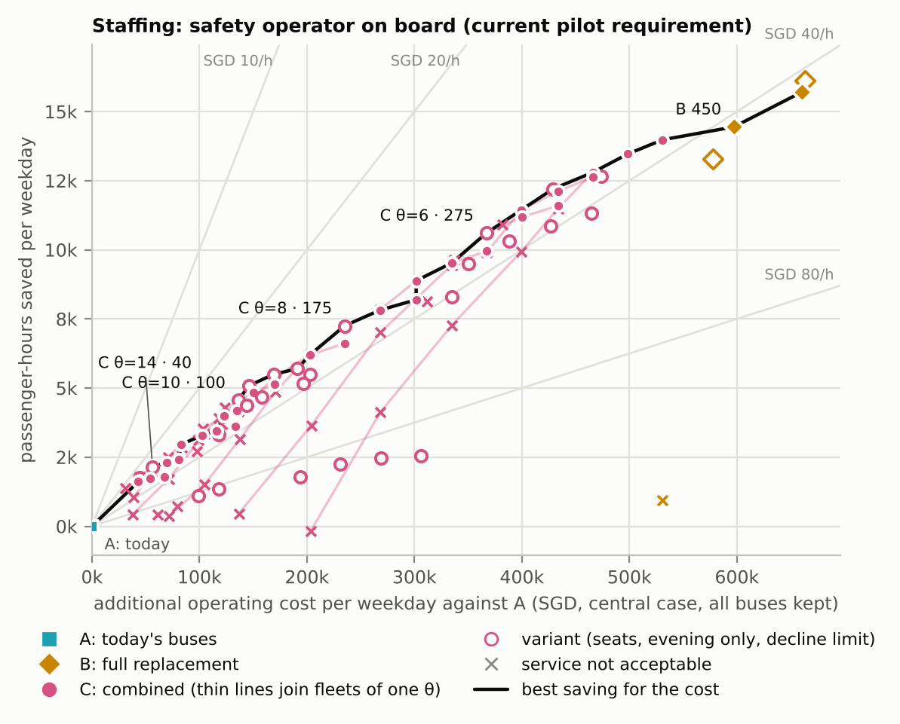
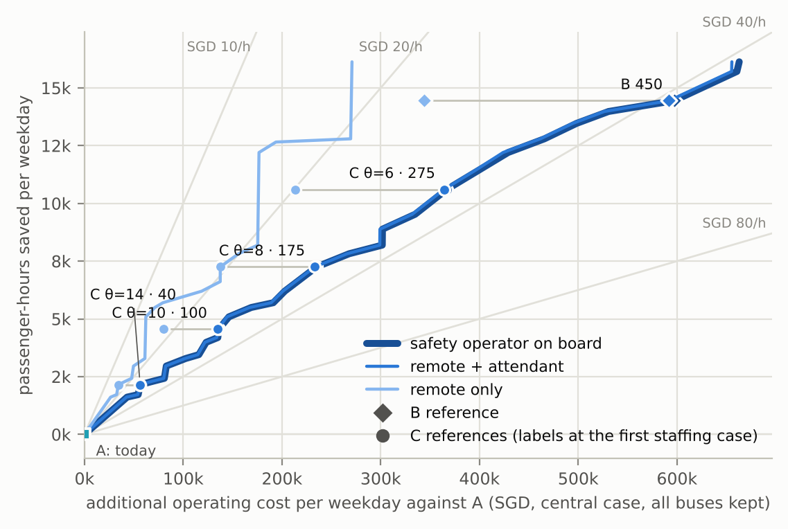
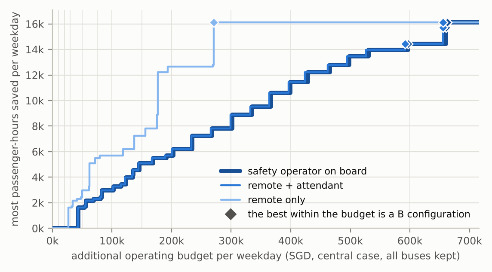
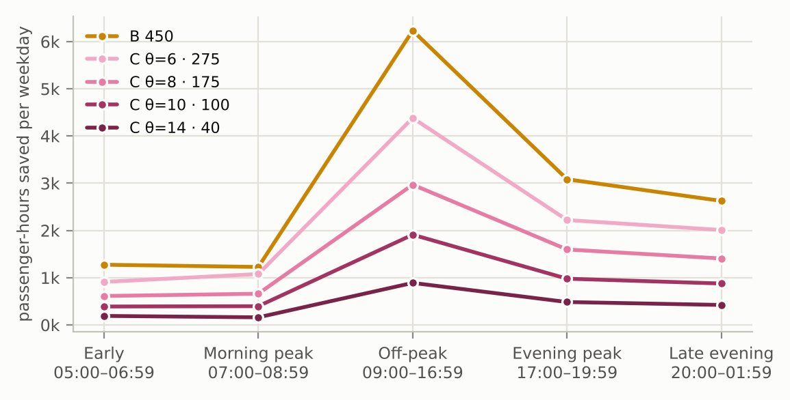
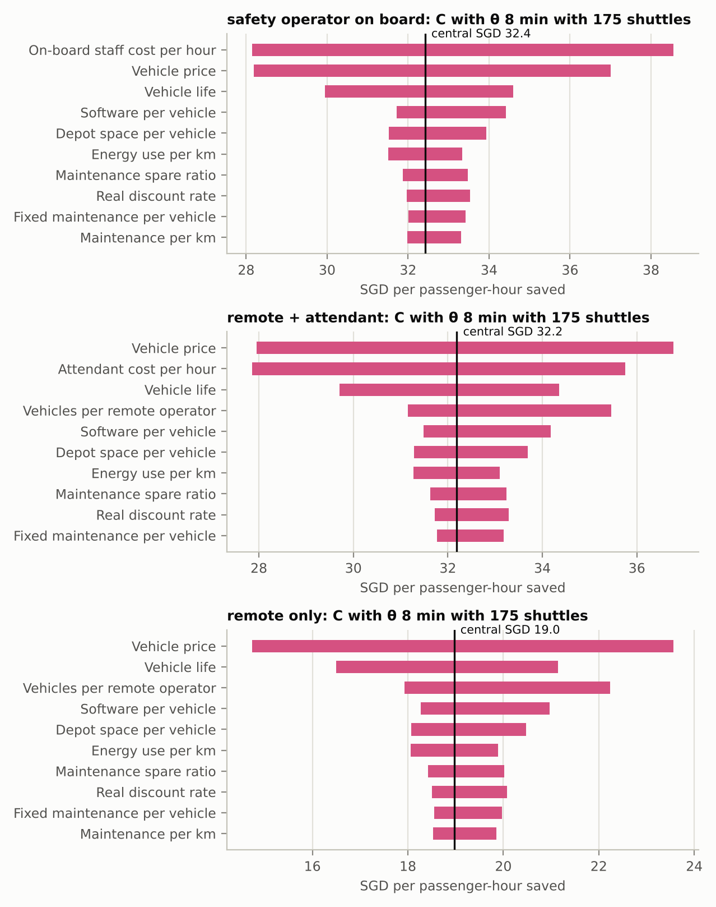

# Driverless Yishun, Phase 2: what would a combined bus and shuttle service cost, and whose time would it save?

**Question.** Can a combined bus and autonomous shuttle service save passenger time at an acceptable
additional operating cost?

Every number below comes from `data/processed/phase2/summary.json` and the generated tables in
[`results.md`](results.md) (section numbers in brackets, e.g. [§3]). Costs are SGD per average
weekday at 2026 prices, excluding GST, rounded to two significant figures; passenger time is stop
to stop (waiting plus riding, no walking).

## Answer in brief

- **Shuttles can save passenger time, but no option tested lowers operating cost.** Every
  configuration with acceptable service costs more to run than today's buses alone [§3]. Whether
  the extra cost is acceptable is a budget choice; the study shows what each budget buys rather
  than one "acceptable" figure.
- **With someone on board, the combined service (C) buys time more cheaply than any full
  replacement (B).** With a safety operator on board, which the current pilots require, the four
  C reference designs save
  2,151–10,602 passenger-hours a weekday (7–33 % of today's 32,559). They add SGD 56,000–370,000 a
  day (central case), or SGD 26–35 per passenger-hour saved. Full replacement with 450 ten-seat
  shuttles saves 14,446 hours for SGD 600,000 a day, or SGD 41 an hour [§1, §3].
- **Staffing controls the conclusion more than any other input.** Remote supervision with nobody on
  board would cut C to SGD 16–20 per passenger-hour saved, and B to SGD 24. A B fleet of 700
  four-seat vehicles would then match C at SGD 17, on a weakly evidenced price that excludes COE.
  That arrangement is not permitted on Singapore's public roads today. Remote supervision with an attendant on board,
  LTA's stated next phase, costs about the same as a safety operator [§3].
- **Against a value of time, the savings fall short of the cost with someone on board.** At the
  central value of in-vehicle time (SGD 19.7 an hour, waiting weighted 1.5) the time saved is
  worth 57–80 % of the added cost with an operator or attendant on board. With remote supervision
  only, it is worth 99–131 %. This is a separate social estimate: time savings are not operator
  revenue [§11].
- **C degrades gracefully under stress; B at its threshold fleet does not.** With 15 % of the
  fleet unavailable, B's 450 shuttles refuse 1,144 riders and lose time against the bus. With at
  most 10 shuttles boarding at once per station, B refuses about 30,000 riders a day, with 450 or
  with 500 vehicles. The C designs keep most of their saving in every stress tested [§8].
- **The time saving depends on the bus model where C looks.** C chooses the rides whose modelled
  bus time is long. If the bus model overstated those rides' bus times by 20 %, C's saving would
  fall by 35–41 % (θ 8 min: from 7,250 to 4,291 hours) [§9].

**Which options merit further study:** small and medium C designs (θ 8–14 min, 40–175 ten-seat
shuttles) as a trial design, under each staffing arrangement. Full replacement does not, as a
near-term option. It needs 3 times today's in-area buses, drives 4.7 times their kilometres, and
collapses at realistic kerb limits. It remains a useful upper bound on the time a shuttle could save.

## Options compared

| | Option | What runs | Bus service |
|---|---|---|---|
| **A** | Current bus | Today's routes and published headways (Phase 1 bus model) | As today |
| **B** | Full shuttle replacement | A fixed fleet of pooled shuttles carries every internal ride (Phase 1's definition) | (i) all buses kept; or (ii) a theoretical bound: the 15 services that carry only internal riders withdrawn |
| **C** | Combined bus + shuttle | Shuttles carry the rides that today's timetable serves worst; every other ride stays on the bus | All buses kept |

B is a theoretical replacement scenario, not a bus withdrawal plan. Its bus case (ii) shows the most
bus cost a full replacement could avoid.

**Option C's rule ("timetable gap").** A ride from stop *o* to stop *d* requested at minute *t* is
offered a shuttle when the bus is expected to be slow for it.
- The test: the expected bus stop-to-stop time exceeds a direct drive between the two stops, plus
  the shuttle's two stops, by at least θ minutes.
- The expected bus time is built from LTA's published routes, headways and first and last buses.
  Everything the rule uses is known before the passenger travels, so eligibility is a fixed table
  of stop pairs by time of day.
- The rule never uses the wait a passenger happens to get on the day. A test checks that tripling
  the simulated bus waits leaves the set of offered rides unchanged (`tests/test_phase2.py`).
- Repositioning uses the expected offered demand from the same table.
- A shuttle request is declined if the best quoted pickup is more than 15 minutes away. The rider
  then takes the bus at today's time (treatment R1; R2 and R3 are tested, §5 below).
- θ sets the coverage. The search ran from 4 to 16 minutes. The four reference designs are θ = 6,
  8, 10 and 14 minutes, each at its service-level fleet.

**Fleet sizes are set by a service standard, not by cost.**
- C: the smallest simulated fleet with at most 1 % of offered rides declined in every hour of every
  simulated day, with every larger simulated fleet also passing [§12].
- B: no rider refused in any hour (Phase 1's parity fleet: 450 ten-seat shuttles).
- Only configurations meeting their standard enter the trade-off frontier and the budget tables.
  Undersized fleets are shown, marked as not acceptable, and never counted as cheap savings.

**Variants.**
- 4- and 20-seat vehicles.
- A 45-minute decline limit.
- Shuttles only after 20:00, when headways are longest, either for every ride or with θ = 8.
- B with a 10 % fleet margin (500 vehicles) in the stress tests.

## What is observed, simulated and assumed

| Status | What |
|---|---|
| **Observed** | Internal bus rides by stop pair and hour (LTA fare-card origin–destination counts, July–August 2026); all Singapore bus rides, used to share Yishun's bus-km between internal and other riders; LTA routes, headway bands, first and last buses; the road network (OpenStreetMap, pinned 22 Oct 2026); road speeds, dwell and headway regularity calibrated on LTA's live bus data (Phase 1) |
| **Simulated** | Shuttle waits, rides, declines and refusals; vehicle-km, empty km, vehicle-hours and kerb use (Phase 1's event-driven simulator, unchanged), on Poisson demand days around the observed average weekday (three per configuration; ten for A and the references) |
| **Modelled** | Bus waits and in-vehicle times (common-lines model on published headways); bus-km and bus-hours inside Yishun |
| **Evidence, with ranges** | Costs: vehicle price, life, energy, maintenance, cleaning, insurance, software, wages, chargers and depot, bus cost per bus-km; the social values of time. Each has a low, central and high value in `data/parameters/cost_cases.json`, with sources in `cost_register.csv` |
| **Assumed** | Values with no usable evidence, labelled as assumptions in the register (staffing ratios, insurance, software, permits, the control centre); the availability estimate (charging and maintenance reserves, an energy balance and not a charging simulation); demand fixed at today's rides; no congestion feedback |

The register has 247 rows behind 36 parameters. A contract value enters a category only after its
inclusions are checked, so a bundled contract is never used as a vehicle price. Vehicles are either
bought (an annuity) or leased, never both.

## Results

### 1. Passenger time



| Option | Rides by shuttle | Passenger-hours saved per weekday (range over 10 simulated days) | Share of A | Mean / 90th percentile, min |
|---|---:|---:|---:|---:|
| A: today's buses | — | — | — | 12.0 / 20.0 |
| B: 450 × 10-seat | 100 % | 14,446 (13,830–14,654) | 44 % | 6.7 / 10.6 |
| C: θ 6 min, 275 | 49 % | 10,602 (10,561–10,659) | 33 % | 8.1 / 12.0 |
| C: θ 8 min, 175 | 29 % | 7,250 (7,188–7,296) | 22 % | 9.3 / 14.1 |
| C: θ 10 min, 100 | 16 % | 4,553 (4,504–4,618) | 14 % | 10.3 / 15.9 |
| C: θ 14 min, 40 | 5 % | 2,151 (2,120–2,193) | 7 % | 11.2 / 18.1 |

- The same 163,069 rides are compared in every option. These are the mean over ten simulated
  days of the internal rides with a bus option; 0.4 % have none and are excluded everywhere.
- No reference design declines or refuses a ride [§1, §4].
- The ranges are random variation between simulated days, nothing more. They are not a
  confidence interval for real-world performance.

### 2. Operating cost



Additional cost per weekday against Option A, with all buses kept [§3]:

| | Safety operator on board | Remote + attendant | Remote only |
|---|---:|---:|---:|
| B: 450 × 10-seat | SGD 600,000 (300,000–1,200,000) | SGD 590,000 | SGD 340,000 (120,000–940,000) |
| B (ii): internal-only services withdrawn | SGD 500,000 | SGD 490,000 | SGD 240,000 |
| C: θ 6 min, 275 | SGD 370,000 (190,000–760,000) | SGD 360,000 | SGD 210,000 |
| C: θ 8 min, 175 | SGD 240,000 (120,000–490,000) | SGD 230,000 | SGD 140,000 |
| C: θ 10 min, 100 | SGD 140,000 (69,000–280,000) | SGD 130,000 | SGD 80,000 |
| C: θ 14 min, 40 | SGD 56,000 (28,000–120,000) | SGD 56,000 | SGD 34,000 |
| **Per passenger-hour saved: B** | **SGD 41** (21–86) | SGD 41 | **SGD 24** (8.3–65) |
| **Per passenger-hour saved: C** | **SGD 26–35** | SGD 26–34 | **SGD 16–20** |

- **Cost structure.** With someone on board, staff are 45–49 % of the shuttle cost, fixed costs
  (vehicles, depot, software, insurance) 43–47 % and distance costs 8 %. With remote supervision
  only, fixed costs are three-quarters [§3].
- **Unit costs.** A C shuttle ride costs SGD 4.6–7.0 with an operator on board and SGD 2.7–4.2
  remote only. B's ride costs SGD 3.7 and 2.1 [§3].
- **Fleet.** The total fleet includes estimated charging and maintenance reserves, an estimate
  and not a charging simulation. B needs 561 vehicles for 450 in service, and C θ 8 needs 220 for
  175 [§2].
- **Today's buses, for context [§10].**
  - All bus services inside Yishun cost about SGD 220,000 a weekday (180,000–300,000).
  - Internal riders account for 53.7 % of their passenger-km, so SGD 120,000 is allocated to
    them, or SGD 0.74 per internal ride. All buses are kept in A and C, so this cost cancels in
    every comparison.
  - The 15 services that carry only internal riders cost SGD 100,000 a weekday (81,000–140,000).
    That is the most a full replacement could avoid (B ii). Even that bound does not bring B
    near today's cost.
  - No feeder frequency reduction is assumed in C. The only published standard, an 8-minute
    peak headway for feeders, is already met by services 800 and 805, and no load profiles are
    public (`sources_sg.md` §9).

**Every configuration with acceptable service increases cost and reduces passenger time** (62 of 62
in each staffing case, central costs). None reduces cost; none increases both.
- One undersized configuration (θ 4 min with 150 shuttles) increases both. It fails the
  service standard.
- Refused and declined rides are counted in every total. No option looks faster by serving
  fewer people.

### 3. Trade-off: what each budget buys





- The frontier is the set of configurations that save more than every cheaper one. In the
  central case it is made of C designs up to about SGD 530,000 a day with someone on board, and up
  to about SGD 270,000 with remote supervision only. Above that, B fleets save more for the extra
  money.
- In the remote-only case, a fleet of 700 four-seat B vehicles matches C's cost per hour saved
  (SGD 17). The 4-seat price rests on weak evidence (central SGD 150,000) and excludes COE and
  registration taxes, which could be large for this class. See "What controls the conclusion".



With a safety operator on board, central case, the most passenger-hours saved within a daily
budget [§6]:

| Budget per weekday | Best configuration | Passenger-hours saved | Per hour saved |
|---:|---|---:|---:|
| SGD 30,000 | none fits | — | — |
| SGD 50,000 | C θ 16, 30 shuttles | 1,613 | SGD 27 |
| SGD 100,000 | C θ 12, 60 | 2,959 | SGD 28 |
| SGD 150,000 | C θ 10, 150 four-seat | 5,088 | SGD 29 |
| SGD 300,000 | C θ 8, 200 | 7,820 | SGD 34 |
| SGD 400,000 | C θ 5, 300 | 11,437 | SGD 35 |
| SGD 600,000 | B 450 | 14,446 | SGD 41 |

- In the low-cost case the same SGD 100,000 buys 5,494 hours; in the high-cost case, 1,613 hours
  [§6].
- With remote supervision only (central), SGD 50,000 buys 2,959 hours and SGD 150,000 buys 7,250.

### 4. Who gains, who loses and who pays



**Who gains: riders whose bus trip is slow compared with a direct drive.** These are the looping
feeders and the long headways early and late in the day.
- For C at θ 8 min, the saving is 23 % of A's passenger-hours in 05:00–06:59, 14 % in the morning
  peak, 24 % off-peak, 21 % in the evening peak and 29 % after 20:00 [§5]. B shows the same
  pattern at a higher level (47, 25, 50, 40 and 54 %).
- Rides to and from the MRT stations and the interchange gain about as much as estate rides
  (23 % against 20 % of their passenger-hours at θ 8) [§5].

**Who loses: very few riders under C.**
- Comparing each ride with the same ride by bus, using one simulated bus wait per ride, 0.0–2.6 %
  of rides in any period arrive later under the C designs.
- Rides that stay on the bus are unchanged, and declined riders keep today's bus time (R1).
- Under B, 8–9 % of all rides arrive later than by bus, and 23.6 % in the morning peak [§5].

**Who pays.** The added operating cost falls on whoever funds the service (SGD 34,000–370,000 a
weekday for the C reference designs, by staffing).
- Bus riders from outside Yishun (46 % of in-area bus passenger-km) are unaffected by C, because
  every bus is kept.
- C also takes riders off buses. Any relief of crowded buses is not counted, because bus crowding
  is not modelled.

### 5. Declined and refused rides

- The C reference designs decline under one ride a day on average in the base case, and no
  reference refuses any [§4]. The treatment choice (R1, R2 or R3) therefore does not change any
  base-case result.
- It matters under stress. With 15 % of the fleet unavailable, C θ 6 declines 1,053 rides a day.
  Its saving is 8,843 hours if they take the bus (R1), 8,250 if each counts 45 minutes plus a
  direct ride (R2), and 8,755 with a 5-minute penalty (R3) [§8].
- B's refusals always count at 45 minutes plus a direct ride, a lower bound on their time.
- A 45-minute decline limit lets C meet the service standard with 9–25 % fewer shuttles at the
  same coverage [§12]. The cost per hour saved does not fall: at θ 8 min, 150 shuttles save 5,500
  hours (SGD 37 an hour with an operator on board) instead of 175 saving 7,250 (SGD 32), because
  more riders wait long [§13].

### 6. What controls the conclusion



**Staffing.** This is the structural switch.
- Moving from an operator on board to remote supervision only cuts the cost per hour saved by about 40 %.
- The remote cases are scenarios, not forecasts. No Singapore 1:N remote-supervision ratio is
  published, and the central ratio of 10 vehicles per operator comes from WeRide's China
  operation.

**Cost parameters, one at a time** (C θ 8 min, 175 shuttles; central SGD 32 per hour saved with an
operator on board):
- The on-board staff wage moves it from SGD 28 to 39.
- The vehicle price moves it from 28 to 37, and the vehicle life from 30 to 35.
- Remote only: the vehicle price moves it from SGD 15 to 24, the vehicle life from 16.5 to 21,
  and vehicles per remote operator from 18 to 22.
- With an attendant on board, the attendant wage moves it from SGD 28 to 36.
- The joint low and high cost cases span roughly half to twice the central cost with someone on
  board, and a third to nearly three times with remote supervision only [§3].

**Thresholds** (central case, C θ 8 min) [§7]:
- *Value-of-time benchmark.* For the cost per hour saved to equal the central value of
  in-vehicle time (SGD 19.7), the added cost would have to be SGD 140,000 a day, against SGD
  240,000 with an operator on board. The on-board wage would have to fall to SGD 2.9 an hour
  (central 28). With remote supervision only, the benchmark is met at central costs. It holds
  while each remote operator watches at least 6.5 vehicles (central 10).
- *Vehicle cost under a budget.* A SGD 150,000 daily budget allows SGD 680 per vehicle-day
  against SGD 1,100 now with an operator on board (SGD 620 remote only).
- *Utilisation.* To cost SGD 4 a ride (Punggol's AV shuttle fare, for context only, not revenue),
  a C shuttle would need 16.8 rides per vehicle-hour with an operator on board; it carries 13.0.
  Remote only, 8.8 suffice. No utilisation in the searched range brings a shuttle ride down to the
  bus's SGD 0.74 per internal ride.

**When C is preferable.**
- C designs are the best use of any daily budget up to the frontier's switch point [§6]. In the
  central case that is about SGD 530,000 a day with someone on board (270,000 in the low-cost
  case, 1.1 million in the high-cost case). With remote supervision only it is about SGD 270,000,
  where 700 four-seat B vehicles take over (65,000–840,000 across the cost cases).
- C is also preferable when the shuttle's own speed or availability is uncertain, because it
  keeps most of its saving under every stress tested.
- C is not preferable to B where the aim is the largest possible saving regardless of cost.

**Time-side uncertainty.**
- The bus-model test [§9]: a 10, 20 or 30 % overstatement of the selected rides' bus times
  removes 20, 41 or 61 % of C θ 8's saving (B: 23, 45, 68 %). The cost per hour saved would rise
  in proportion.
- In Phase 1, observed bus GPS movement took 0.99 times the modelled time at midday and 1.02
  times in the evening peak. That check covers bus running times across the network, not the
  feeder-loop pairs C selects, nor their waits. Checking those pairs is the most important missing
  validation.

### 7. Stress tests

Passenger-hours saved against Option A in the same conditions (mean of three simulated days) [§8]:

| Condition | B 450 | B 500 | C θ 6, 275 | C θ 8, 175 | C θ 14, 40 |
|---|---:|---:|---:|---:|---:|
| Base case | 14,446 | 15,711 | 10,602 | 7,250 | 2,151 |
| Roads and buses slower | 11,488 | — | 9,540 | 6,720 | 2,072 |
| Evening-peak speeds all day | 15,043 | — | 11,669 | 8,004 | 2,382 |
| Shuttles 25 % slower | 3,736 | — | 8,200 | 5,757 | 1,862 |
| 15 % of the fleet unavailable | −8,065 (1,144 refused) | 12,486 | 8,843 (1,053 declined) | 6,164 | 1,982 |
| Kerb: 10 shuttles at once per station | −113,445 (31,382 refused) | −126,790 (30,240 refused) | 10,557 | 7,245 | 2,132 |
| Kerb: 7 at once | −171,491 (58,752 refused) | — | 8,280 (1,978 declined) | 7,259 | 2,132 |
| Combined: slower roads, 15 % unavailable, kerb 7 | −139,518 | −153,577 | 7,400 (2,579 declined) | 5,532 | 1,869 |

- B is sized at its threshold, so it is also run with a 10 % margin (500 vehicles). The margin
  absorbs the loss of availability but not the kerb limit: the stations are where B's demand is.
- C's shuttles serve a minority of each station's rides, so kerb limits barely touch them.
- Speed stresses scale road times for buses and shuttles alike. They are not a congestion model:
  added shuttle traffic slows nothing.

### 8. Social estimate (separate from operator cost)

- The valuation is in-vehicle hours saved plus 1.5 × waiting hours saved, at SGD 19.7 an hour.
  That is the central value from an LTA-commissioned 2015 stated-choice study (Hess et al.,
  2017), brought to 2026 prices.
- The time saved is worth SGD 340,000 a weekday for B and SGD 45,000–250,000 for the C designs.
- Value ÷ added cost [§11]:
  - with an operator or attendant on board: 0.57 (B) and 0.67–0.80 (C);
  - with remote supervision only: 0.99 (B) and 1.15–1.31 (C).
- With low values of time (SGD 8.5, weight 1.3) no case reaches 1. With high values (SGD 24.3,
  weight 2.0), only the smallest C design does so with someone on board (1.04).

## Which options merit further study, and under what conditions

1. **C at θ 8–14 min with 40–175 ten-seat shuttles.**
   - It costs SGD 56,000–240,000 a day with an operator on board, for 2,151–7,250 passenger-hours.
   - It needs a fleet of 51–220 vehicles, including reserves. Singapore's whole autonomous
     passenger fleet is 16 vehicles (MOT, Sep 2026; Phase 1).
   - It merits a trial design where buses loop or run rarely: early mornings, late evenings and
     the estate pairs the timetable serves worst.
   - Its case strengthens if remote supervision is permitted, and weakens if the bus model
     overstates bus times on the selected pairs.
2. **C at θ 6 min (275 shuttles)** saves more, at a higher cost per hour (SGD 35 on board). It
   is a second step, not a first.
3. **B** is not a near-term option.
   - It needs 450 shuttles in service (561 with reserves), against 152 buses in the area at 07:00.
   - It drives 159,866 km a day, against 33,871 bus-km.
   - It fails at kerb limits of 10 per station and with 15 % of the fleet unavailable at its
     threshold size.
   - It stays useful as the upper bound of the time shuttles could save.
4. **Evening-only service** is not cost-effective (SGD 88–120 per hour saved on board). A fleet
   used seven hours a day still carries a full day's vehicle cost.
5. **Vehicle size.** 20-seat vehicles cost more per hour saved than 10-seat ones in every case
   [§13]. 4-seat vehicles look cheaper only with remote supervision only, and only through a
   weakly evidenced price without COE.

## Evidence still needed

1. **Bus times on the pairs C selects.** Validate modelled waits and in-vehicle times on feeder
   loops and early and late headways against GPS or fare-card tap-out times. This is the largest
   time-side uncertainty.
2. **Staffing rules.** The permitted remote-supervision ratio and the conditions for removing the
   on-board operator (`sources_av.md` §12). Punggol's operator, control-room and intervention
   hours.
3. **Singapore vehicle quotations** with software, support and warranty itemised; the
   registration category, COE and tax treatment of AV shuttles, above all for 4-seat vehicles.
4. **Availability.** Uptime, charging and maintenance data from the Punggol and other AV fleets.
   The reserves here are estimates.
5. **Insurance quotes, depot grid-connection costs** and incident rates, now assumptions.
6. **Bus loads by service and hour**, to test any feeder frequency reduction under the 8-minute
   standard.
7. **Kerb capacity at Yishun, Khatib and the interchange** for shuttle boarding.

## Limits

[`limits.md`](limits.md) lists each limit, whom it favours and how it is handled. The most
important:
- no congestion feedback (favours shuttles);
- a fixed fleet all day (raises shuttle cost);
- demand fixed at today's rides;
- bus crowding not modelled (C's relief of buses is not counted);
- charging as an energy-balance estimate;
- vehicle prices without COE and registration taxes;
- remote cases that are not permitted today.

## Reproduce

```bash
make data                  # inputs, including the pinned OpenStreetMap extract
make phase2-allocation     # who uses Yishun's bus-km (needs the July + August 2026 full OD files)
make phase2-experiments    # 468 simulated days: coarse, refine, capacity, wmax, window, stress, replicates (about 1.5 h on 4 cores)
make phase2-results        # summary.json, page data, these charts and results.md
make test                  # includes the output-consistency checks
make web && make serve     # the study page, Phase 2 chapter at /study.html#phase2
```

- Every grid records its commit, input digests, model key and whether tracked pipeline files were
  modified (`data/processed/phase2/<grid>/config.json`). The summary repeats these per grid, with
  the cost file's digest [results.md, top].
- The final runs all came from commit `6e0c8ab` with a clean tree and model key `213e91ad1ee8`.
- `tests/test_phase2_outputs.py` recomputes the headline savings from the run files. It also
  checks that the page data and `results.md` equal a fresh build from the summary.

**Files.**
- Code: `pipeline/yishun/costs.py`, `pipeline/yishun/phase2/`.
- Parameters and sources: `data/parameters/cost_cases.json`, `data/parameters/cost_register.csv`,
  [`sources_av.md`](sources_av.md), [`sources_sg.md`](sources_sg.md).
- Raw runs: `data/processed/phase2/<grid>/runs.parquet`, `hourly.parquet`, `groups.parquet`.
- Summary: `data/processed/phase2/summary.json`. Tables: [`results.md`](results.md). Charts:
  `img/`.
- Definitions: [`definitions.md`](definitions.md). Audit of the Phase 1 baseline:
  [`audit.md`](audit.md).
